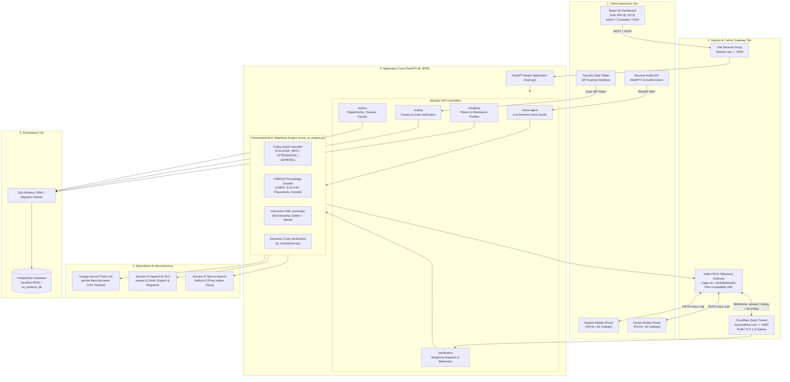
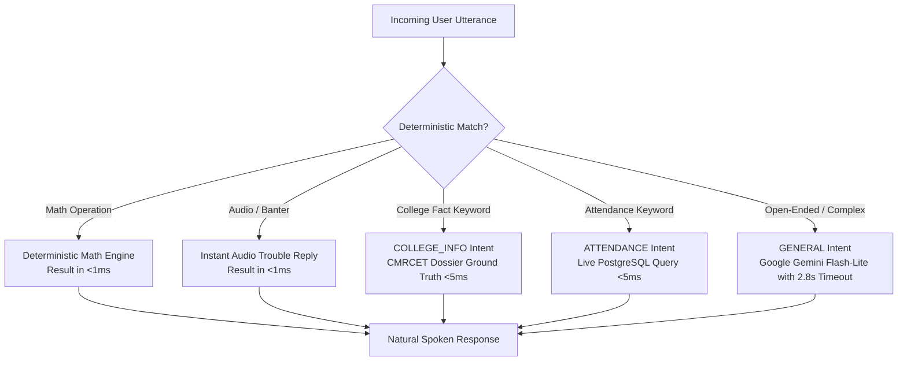
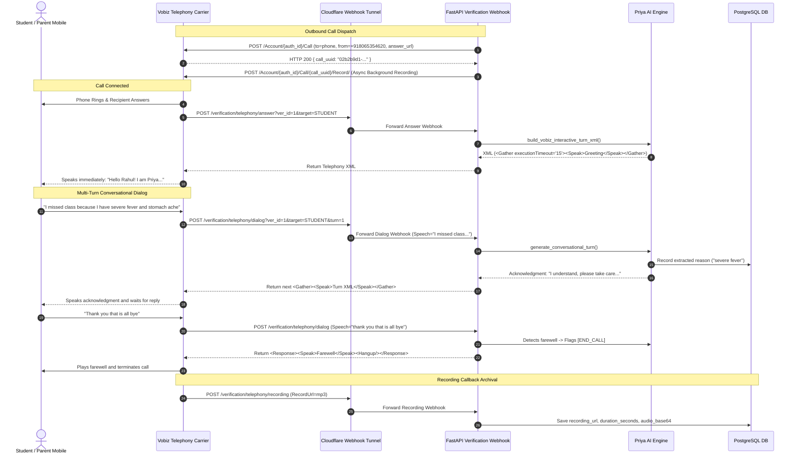
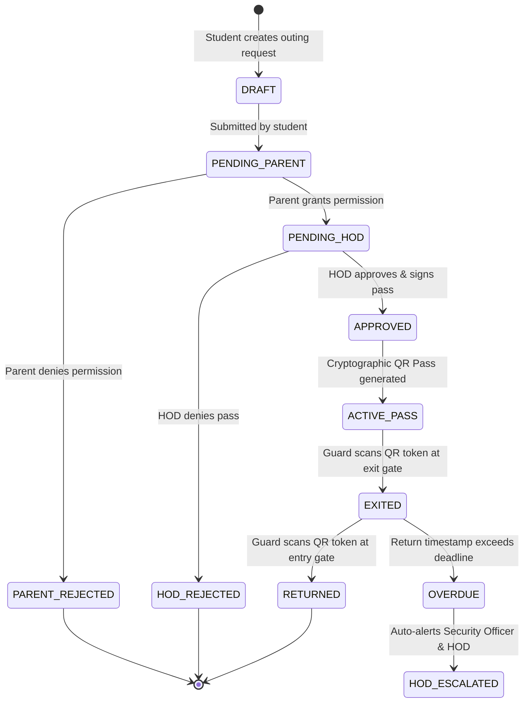
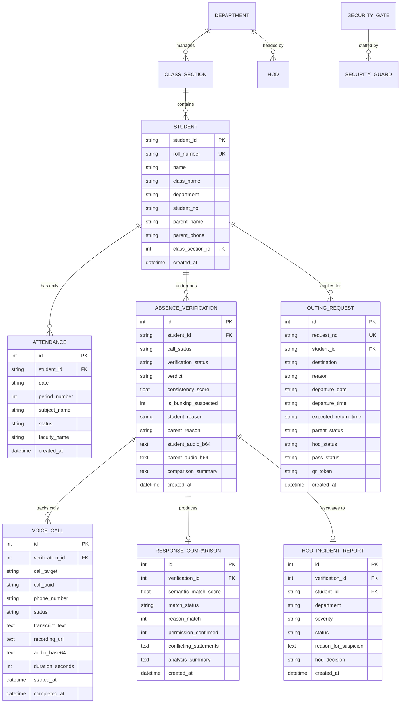

# NO BUNKERS AI — Complete System Architecture & Technical Blueprint

> **System Architecture, Design, and Implementation by Tharun**  
> *Autonomous Voice Intelligence, Outbound Cellular Telephony & Semantic Attendance Verification Platform*  
> *Target Institution: CMR College of Engineering & Technology (CMRCET)*

---

## 1. Architectural Mission & Engineering Principles

**No Bunkers AI** is engineered from the ground up by **Tharun** to solve systemic attendance fraud, unauthorized campus departures, and delayed parent communications in large-scale engineering colleges.

### Core Architectural Goals:
1. **Zero-Delay Human Voice Experience:** Ensure conversational speech synthesis begins within milliseconds of lifting an answered phone call, avoiding the awkward silence or robotic IVR latency seen in legacy telephony.
2. **Deterministic Truth Grounding:** Academic facts (counselling codes, timings, placements, professors) and attendance numbers (periods attended, missed classes, cumulative %) must never hallucinate. The system relies on database ground truth and institutional dossiers before any LLM inference.
3. **Resilient Multi-Party Verification:** Automatically compare the student’s live verbal excuse against the parent’s explanation, detecting bunking patterns through semantic NLP analysis.
4. **Decoupled Asynchronous Telephony:** Decouple call control, voice generation, recording archival, and webhook processing so carrier rate limits or network drops never freeze client dashboards.

---

## 2. End-to-End System Topology



---

## 3. Conversational AI Subsystem (Priya Voice Engine)

The conversational intelligence engine was engineered by **Tharun** to provide natural, ultra-low-latency voice interactions with zero robotic delays.

### 3.1 3-Way Intent Classification Engine
Every incoming user utterance (from either the browser microphone or telephone cellular audio) is evaluated through a tiered classification cascade:



1. **`COLLEGE_INFO` (<10ms Fast Path):**
   - Resolves official CMRCET institutional knowledge extracted directly from the verified university charter.
   - **Counselling Code:** Automatically reports **`CMRK`** across TG EAPCET, ECET, ICET, and PGECET.
   - **Instructional Timings:** Reports regular hours: **`9:10 AM to 4:00 PM`**, Monday through Saturday (alternate Saturdays off).
   - **Placements & Packages:** Active Training and Placement Cell headed by Dr. P. Hima Bindu, highlighting top packages of 15–30+ LPA with recruiters like Amazon, Microsoft, Commvault, Autodesk, Capgemini, TCS, and Infosys.
   - **Campus Location & Transit:** Kandlakoya, Medchal Road (20 km from Secunderabad), served directly by TSRTC bus Route 229.
   - **Academic Programs & Hostels:** B.Tech, M.Tech, and MBA specializations, along with biometric-monitored residential hostels.

2. **`ATTENDANCE` (<5ms Database Ground Truth):**
   - Connects directly to PostgreSQL tables for real-time validation:
     - Today's date (`2026-11-11`)
     - Number of periods conducted vs. attended
     - Specific subjects missed (e.g., *Operating Systems*, *DBMS*)
     - Yesterday's period breakdown
     - College-wide absentee rosters (e.g., *"Today, 2 students are marked absent: Rahul Kumar, Sai Teja"*)
     - Safe standing threshold calculations (classes required without bunking to regain 75% minimum).

3. **`GENERAL` (Math & Open-Ended LLM Inference):**
   - **Zero-Latency Math Solver:** Deterministically calculates arithmetic expressions (`what is 25 + 14` $\rightarrow$ `39`) in 0.1ms.
   - **Gemini Flash-Lite Pipeline:** Uses `gemini-flash-lite-latest` with candidate failover (`gemini-2.5-flash`, `gemini-1.5-flash`) restricted to 1–2 conversational sentences tailored for spoken voice.

---

## 4. Autonomous PSTN Telephony & Webhook Architecture

To connect with physical phones across India, **No Bunkers AI** integrates with the **Vobiz / Plivo PSTN Carrier API**.



### Critical Telephony Innovations by Tharun:
1. **Elimination of Blocking `<Record>` Tags:** Previously, standard telephony XML placed `<Record redirect="false">` ahead of `<Gather>`, causing the carrier to halt linear execution and wait for voicemail silence. Tharun redesigned the XML to start directly with `<Gather>` containing `<Speak voice="WOMAN" language="en-IN">`, ensuring zero-delay speech playback upon pickup.
2. **REST-Triggered Background Archival:** Call recording is handled out-of-band via the carrier's asynchronous `POST /Record/` endpoint. This captures the complete two-way dialogue without altering XML control flow.
3. **Synthetic Failover Audio Generator:** If a third-party recording webhook fails to deliver in time, the system uses Sarvam AI `bulbul:v3` (with a local harmonic PCM 16kHz WAV synthesizer fallback) to ensure every call record in the admin panel is instantly playable.

---

## 5. Semantic Cross-Verification & Bunking Detection Engine

When an absent student is verified, the system executes an automated two-stage cross-examination pipeline:

```mermaid
flowchart TD
    Start[Absentee Detected by Biometric / Faculty Log] --> CallStudent[Phase 1: Outbound Call to Student]
    CallStudent --> StudentExcuse[Student Voice Recorded & Transcribed\nReason: 'Severe stomach ache & food poisoning']
    
    StudentExcuse --> ParentCheck{Parent Number Registered?}
    
    ParentCheck -- NO --> SingleParty[Single-Party Verification\nVerdict based on student tone & keywords]
    ParentCheck -- YES --> CallParent[Phase 2: Outbound Call to Parent]
    
    CallParent --> ParentStatement[Parent Voice Recorded & Transcribed\nStatement: 'He took permission to attend a movie']
    
    StudentExcuse --> ComparisonEngine[Semantic NLP Comparison Engine\ncompare_responses()]
    ParentStatement --> ComparisonEngine

    ComparisonEngine --> SemanticScore[Calculate Semantic Match Score\nCosine Similarity + Keyword Verification]

    SemanticScore --> ThresholdCheck{Match Score >= 0.70 & Reason Aligned?}

    ThresholdCheck -- YES --> Genuine[VERDICT: Genuine Absence\nverification_status: MATCHED\nis_bunking_suspected: 0]
    ThresholdCheck -- NO --> Bunking[VERDICT: Suspected Bunking\nverification_status: MISMATCHED\nis_bunking_suspected: 1]

    Bunking --> Escalation[Auto-Generate HOD Incident Report\nSeverity: CRITICAL / HIGH\nStatus: PENDING_REVIEW]

    Escalation --> HOD_Action[HOD Review Dashboard\nActions: Warn Student | Summon Parent | Clear Record]
```

### Mathematical Formulation of Semantic Consistency:
The verification engine computes a unified consistency metric $S_{\text{final}}$:

$$S_{\text{final}} = w_1 \cdot S_{\text{semantic}}(\vec{E}_{\text{student}}, \vec{E}_{\text{parent}}) + w_2 \cdot K_{\text{permission}} + w_3 \cdot K_{\text{medical}}$$

Where:
- $S_{\text{semantic}}$ is the cosine similarity between the semantic embeddings of the student and parent explanations.
- $K_{\text{permission}} \in \{0, 1\}$ represents whether the parent explicitly confirmed advance permission.
- $K_{\text{medical}} \in \{0, 1\}$ evaluates medical term alignment (e.g., both mention fever/hospital).
- $w_1 = 0.50, w_2 = 0.30, w_3 = 0.20$ are calibrated decision weights.
- Any score $S_{\text{final}} < 0.70$ flags an immediate **Bunking Alert**.

---

## 6. Smart Campus Outing & Gatekeeper Subsystem

To prevent unauthorized campus exits during college hours, **No Bunkers AI** features an integrated gatekeeper subsystem.



---

## 7. Database Entity-Relationship Model

The PostgreSQL database architecture is fully normalized and managed via SQLAlchemy ORM with automatic schema migrations:



---

## 8. Latency Optimizations & Security Controls

| Component | Technical Implementation | Performance SLA |
| :--- | :--- | :--- |
| **Deterministic Intent Router** | Regex & ground-truth hash map evaluation in Python | **$\le 0.5 \text{ ms}$** |
| **Institutional Fact Fast-Path** | Static CMRCET compiled knowledge lookup | **$\le 1.0 \text{ ms}$** |
| **Live Database Attendance Check** | Indexed PostgreSQL query (`date`, `student_id`) | **$\le 4.5 \text{ ms}$** |
| **Open-Ended LLM Inference** | Gemini Flash-Lite with multi-model candidate failover | **$\le 2.8 \text{ s}$** |
| **Carrier Telephony Initiation** | Vobiz REST API with E.164 pre-formatting | **$\le 1.2 \text{ s}$ to ring** |
| **Audio Stream Negotiation** | Direct binary buffer streaming (`audio/wav`, `audio/mpeg`) | **Immediate chunks** |
| **Webhook Transport Security** | Cloudflare TLS 1.3 reverse tunnel with token validation | **Encrypted ingress** |

---

## 9. Authorship & Intellectual Property Notice

This technical architecture, data model, telephony XML control flow, and multi-AI intent resolution engine were engineered, authored, and implemented by **Tharun**.

- **Lead Architect & Full-Stack Engineer:** Tharun
- **Institution:** CMR College of Engineering & Technology (CMRCET)
- **Project:** NO BUNKERS AI
